# 🤖 TP1 : Déploiement d'un Portfolio Next.js avec Ansible et Semaphore UI

📄 **[Télécharger le rapport complet du TP1 (PDF)](./TP1_partie1.pdf)**

Ce dépôt contient l'Infrastructure as Code (IaC) pour automatiser le déploiement de l'application Next.js sur une machine virtuelle Ubuntu 24.04.

## 🛠️ Architecture et Technologies
*   **Serveur cible** : Ubuntu 24.04 (IP : `192.168.159.20`)
*   **Application** : Next.js (port 3000) gérée par **PM2**.
*   **Reverse Proxy** : **Nginx** (port 80).
*   **Orchestration** : **Semaphore UI** (via Docker).

---

## 🚀 1. Préparation et Configuration d'Ansible

### Installation d'Ansible
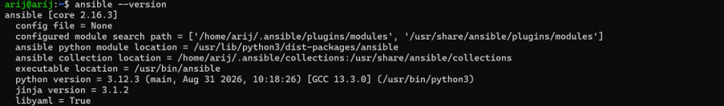

### Création de la structure du projet
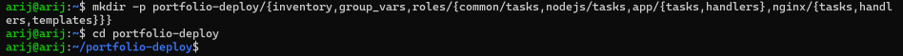

### Configuration d'Ansible (`ansible.cfg`)
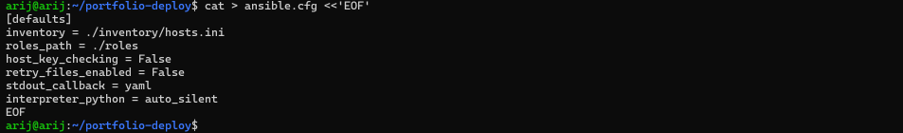

### Configuration de l'inventaire (`hosts.ini`)
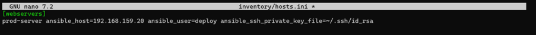

### Variables globales (`all.yml`)
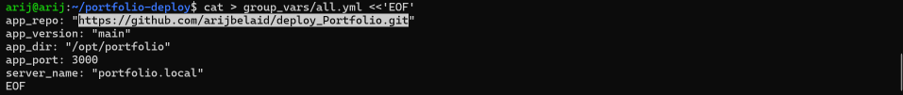

---

## ⚙️ 2. Exécution du Playbook

### Test en mode Dry-run
Vérification des changements sans appliquer les modifications réelles.
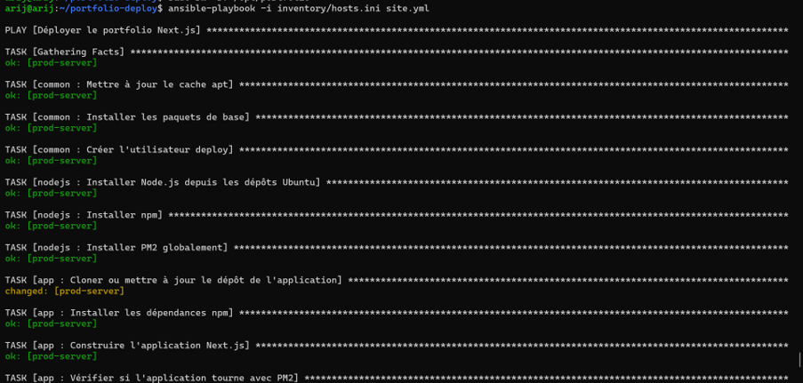
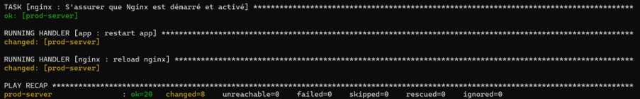

### Première exécution réelle
Déploiement complet de l'infrastructure.
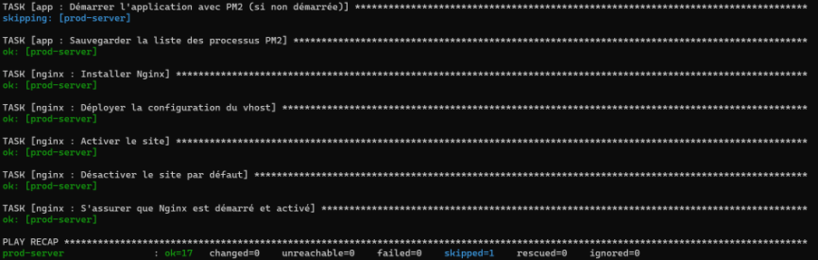

### Vérifications post-déploiement
Statut du processus PM2 :
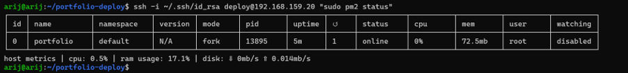

Statut du serveur Nginx :
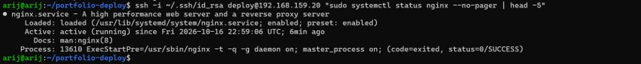

### L'application déployée
L'application Next.js est accessible via le navigateur sur l'IP du serveur.
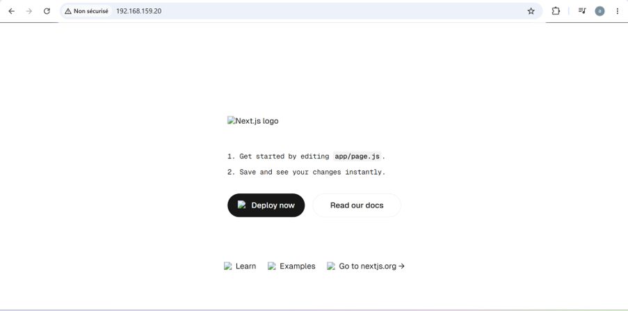

---

## 🖥️ 3. Industrialisation avec Semaphore UI

### Lancement de Semaphore UI
Lancement du conteneur Docker de Semaphore.
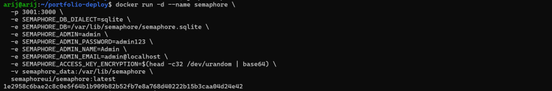

### Page de connexion Semaphore UI
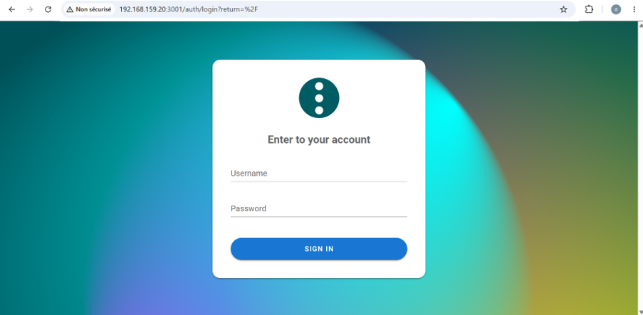

### Création du projet
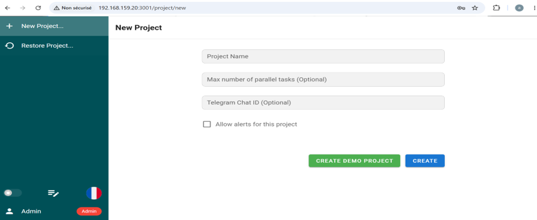

### Dashboard Semaphore UI
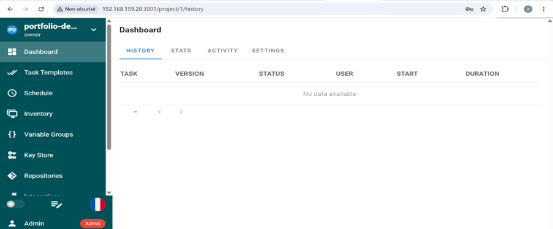

---

## 🔑 4. Configuration des objets Semaphore

### Ajout de la clé SSH pour le serveur cible :
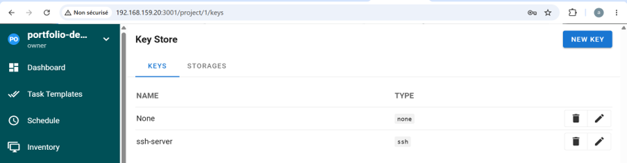

### Ajout de la clé SSH pour GitHub :
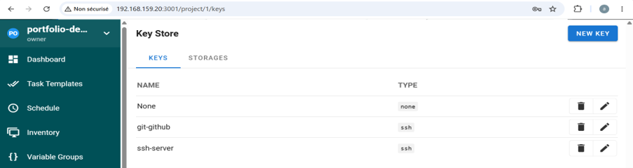

### Ajout du dépôt Git (`portfolio-repo`) :
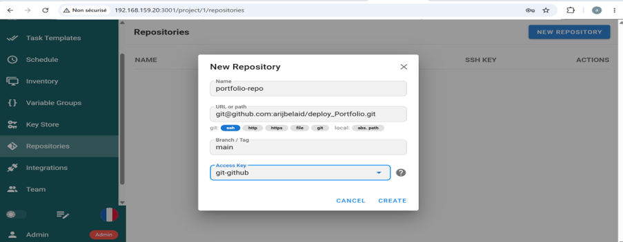

Configuration de l'inventaire (`prod-server`) :
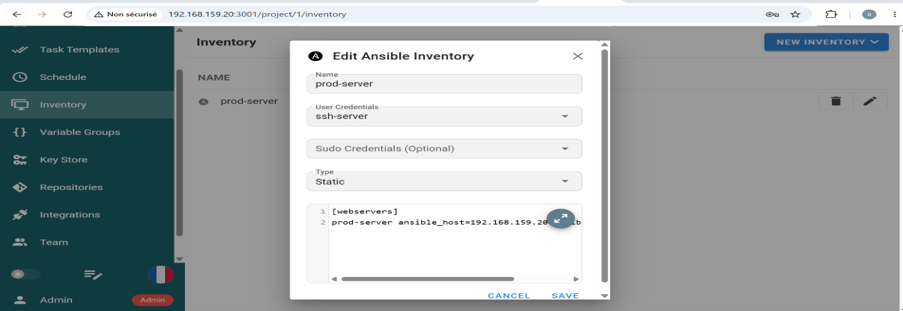

Configuration du groupe de variables (`portfolio-vars`) :
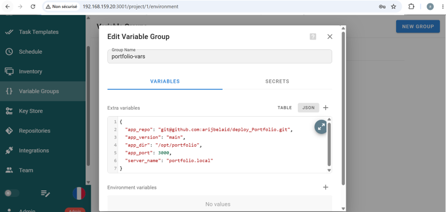

Création du modèle de tâche (`Deploy Portfolio`) :
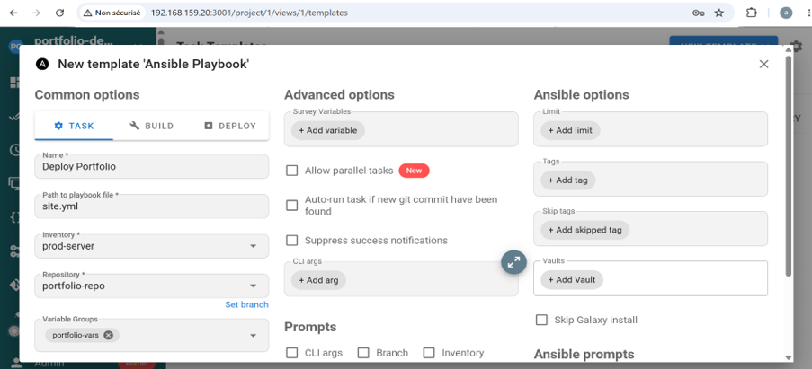

lancement :
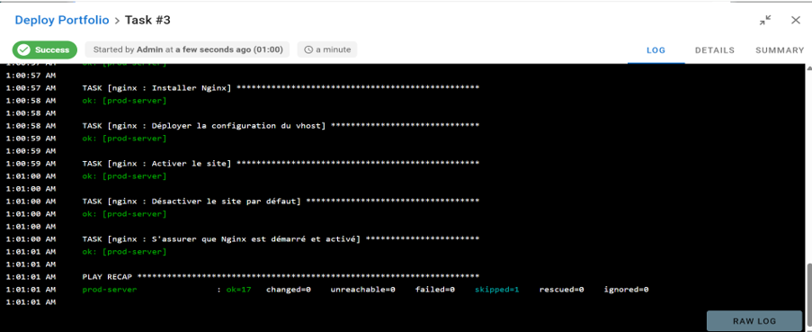

---
*Réalisé par [Arij Belaid](https://github.com/arijbelaid)*
